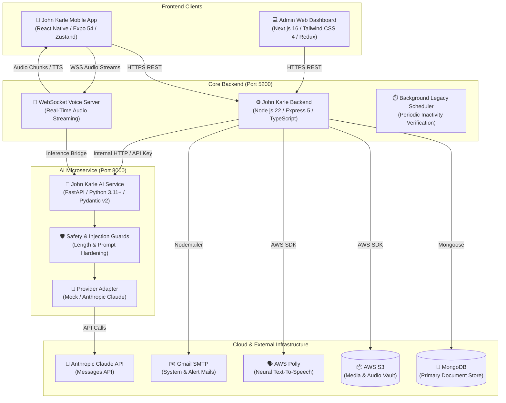

# 🕊️ John Karle (Lineage.AI)

<div align="center">

[](https://www.typescriptlang.org/)
[](https://nodejs.org/)
[](https://www.python.org/)
[](https://fastapi.tiangolo.com/)
[](https://reactnative.dev/)
[](https://nextjs.org/)
[](https://www.mongodb.com/)
[](https://aws.amazon.com/)

**Preserving human stories, voices, and wisdom across generations with AI-powered memory vaults and real-time interactive personas.**

[Features](#-key-features) • [Architecture](#-system-architecture) • [Project Structure](#-repository-structure) • [Getting Started](#-getting-started) • [Environment Config](#-environment-variables) • [API & Documentation](#-api-endpoints--documentation) • [License](#-license)

---

</div>

## 📖 Overview

**John Karle** (branded in-app as **Lineage.AI**) is an enterprise-grade, multi-platform legacy preservation ecosystem. It empowers individuals and families to capture memories, voice notes, photos, and life wisdom into an immutable memory vault. 

Using conversational AI and real-time voice streaming, future generations can listen to and interact with living memories, quotes, and persona-driven audio conversations. The platform features an automated legacy transfer engine, trusted contact workflows, and a comprehensive administrative oversight suite.

---

## ✨ Key Features

### 🎙️ AI Memory Chat & Real-Time Voice Calls
- **Interactive Persona Conversations:** Converse with preserved memories through contextual semantic search and persona prompting.
- **Real-Time Voice Streaming:** WebSocket-based bidirectional audio streaming with live STT (Speech-to-Text) and AWS Polly neural voice synthesis.
- **ChatGPT-Style Voice Orb:** Fluid, animated audio-reactive UI for natural voice interactions.
- **Provider Agnostic AI:** Seamless switching between deterministic local mock engines and Anthropic Claude (`claude-sonnet-4-6`).

### 🏛️ Digital Memory Vault & Timeline
- **Rich Story Storage:** Store text, photos, audio clips, and tags into structured timeline milestones.
- **Cloud Media Storage:** Direct-to-cloud AWS S3 integration for high-fidelity media retention.
- **Granular Privacy & Access:** Public, private, and family-restricted memory tiers.

### 🛡️ Automated Legacy Mode & Trusted Contacts
- **Inactivity & Trigger Detection:** Automated background scheduler monitors account activity thresholds.
- **Secure Verification Workflows:** Multi-step verification, legal guardian handover, and access rule transfers for designated beneficiaries.
- **Family Access Management:** Invitation links, role delegations, and permission management.

### 📊 Administrative & Executive Dashboard
- **Analytics & Health Metrics:** Platform activity, storage allocation, and user trends.
- **Bulk Communication:** Template-driven email notifications via SMTP.
- **Audit Trails & Security:** Comprehensive audit logs, user moderation, report/feedback handling, and role-based permissions (Super Admin, Admins).

---

## 🏗️ System Architecture



---

## 📁 Repository Structure

```text
John-Karle/
├── john karl-app/              # 📱 Cross-platform Mobile Application (React Native / Expo)
│   ├── app/                    # Expo Router file-based screens & navigation
│   │   ├── (tabs)/             # Main dashboard tabs (Home, Stories, Timeline, Vault)
│   │   ├── add-memory/         # Memory creator workflow (Story, Tags, Save)
│   │   ├── auth/               # Sign-in, sign-up, password reset, verification
│   │   ├── chat/               # Memory chat & real-time voice call orb
│   │   ├── family-access/      # Shared family permission management
│   │   ├── legacy-mode/        # Beneficiary setup, transfer rules, triggers
│   │   └── profile/            # User profile, preferences, and security
│   ├── components/             # Reusable UI primitives, voice orb, modals
│   ├── services/               # REST API and WebSocket speech clients
│   └── store/                  # Zustand state stores (auth, memory, notifications)
│
├── john karl-backend/          # ⚙️ Primary REST API & WebSocket Server (Node.js / Express 5)
│   ├── src/
│   │   ├── config/             # Envalid environment validation & settings
│   │   ├── middleware/          # JWT auth, rate-limiters, multer, error handlers
│   │   ├── modules/            # Domain-driven feature modules
│   │   │   ├── admin/          # Platform administration & analytics
│   │   │   ├── audit-logs/     # Immutable event logging
│   │   │   ├── auth/           # Authentication, refresh tokens, credentials
│   │   │   ├── email-templates/# HTML email templates & rendering
│   │   │   ├── legacy-access/  # Transfer scheduler, rules, and beneficiary routes
│   │   │   ├── memory-chat/    # Text & WebSocket streaming voice calls
│   │   │   ├── memory-vault/   # Memory CRUD, categories, media uploads
│   │   │   ├── notifications/  # In-app alerts and push triggers
│   │   │   └── trusted-contacts# Nominated contacts & verification workflows
│   │   └── utils/              # S3 uploader, Polly TTS client, AI bridge
│   └── tests/                  # Vitest integration and unit test suite
│
├── john karl-AI/               # 🧠 AI Reasoning & Inference Engine (FastAPI / Python)
│   ├── app/
│   │   ├── api/v1/endpoints/   # AI generate, memory-chat, memory-quote routes
│   │   ├── core/               # Configuration, security, logging
│   │   ├── providers/          # Deterministic Mock & Anthropic Claude adapters
│   │   ├── schemas/            # Pydantic v2 data validation schemas
│   │   └── services/           # Conversation stores & memory persona renderers
│   ├── evals/                  # Evaluation benchmarks, cases, and LLM judge
│   └── tests/                  # Pytest test suite
│
└── john karl-dashboard/        # 💻 Executive & Admin Web Portal (Next.js 16 / React 19)
    ├── app/                    # Next.js App Router pages (Dashboard, Auth, Metrics)
    ├── components/             # Admin charts, user tables, bulk email composers
    ├── lib/                    # Redux store, RTK Query API slices, auth storage
    └── public/                 # Static branding assets and icons
```

---

## 🚀 Getting Started

### Prerequisites

| Tool | Version Requirement | Purpose |
| :--- | :--- | :--- |
| **Node.js** | `>= 20.x` (v22 LTS recommended) | Backend, Dashboard, and Mobile dependencies |
| **pnpm** | `>= 10.x` | Package manager for Backend and Dashboard |
| **Python** | `>= 3.11+` | Runtime for FastAPI AI service |
| **MongoDB** | `>= 6.x+` (Local or Atlas) | Primary database |
| **Expo CLI** | Latest (`npx expo`) | Mobile development toolchain |

---

### Step 1: Clone Repository

```bash
git clone https://github.com/IH-Arik/John-Karle.git
cd John-Karle
```

---

### Step 2: Configure & Start Core Backend

The backend server manages business logic, media storage, and WebSockets.

```bash
cd "john karl-backend"

# Install dependencies
pnpm install

# Copy environment variables
cp .env.example .env
# Windows PowerShell: Copy-Item .env.example .env

# Run development server
pnpm dev
```
> Server runs on **`http://localhost:5200`** (Swagger docs at `/docs`).

---

### Step 3: Configure & Start AI Microservice

The AI microservice handles persona reasoning, contextual chats, and memory quotes.

```bash
cd "../john karl-AI"

# Create and activate virtual environment
python -m venv .venv

# On Linux/macOS:
source .venv/bin/activate
# On Windows PowerShell:
.\.venv\Scripts\Activate.ps1

# Install editable package with dev dependencies
python -m pip install -e ".[dev]"

# Configure environment (defaults to deterministic local mock provider)
cp .env.example .env
# Windows PowerShell: Copy-Item .env.example .env

# Start FastAPI server
python -m uvicorn app.main:app --reload --port 8000
```
> AI service runs on **`http://localhost:8000`** (Interactive OpenAPI at `/docs`).

---

### Step 4: Configure & Start Admin Dashboard

```bash
cd "../john karl-dashboard"

# Install dependencies
pnpm install

# Copy environment variables
cp .env.example .env.local
# Windows PowerShell: Copy-Item .env.example .env.local

# Run Next.js in development mode
pnpm dev
```
> Admin portal runs on **`http://localhost:3000`**.

---

### Step 5: Start Mobile Application

```bash
cd "../john karl-app"

# Install dependencies
npm install

# Configure environment pointing to backend
cp .env-example .env
# Windows PowerShell: Copy-Item .env-example .env

# Start Expo development server
npx expo start
```
> Scan the QR code using the **Expo Go** app on Android/iOS, or press `a` for Android Emulator / `i` for iOS Simulator.

---

## ⚙️ Environment Variables

Each subsystem maintains an isolated `.env.example` file. Key parameters include:

### Backend (`john karl-backend/.env`)
```ini
PORT=5200
NODE_ENV=development
MONGODB_URI=mongodb://localhost:27017/john-karle
JWT_SECRET=your_jwt_secret_key
JWT_REFRESH_SECRET=your_jwt_refresh_secret_key
AWS_REGION=us-east-1
AWS_ACCESS_KEY_ID=your_aws_key
AWS_SECRET_ACCESS_KEY=your_aws_secret
AWS_S3_BUCKET_NAME=your_s3_bucket
AI_SERVICE_URL=http://localhost:8000
AI_SERVICE_API_KEY=your_internal_key
```

### AI Service (`john karl-AI/.env`)
```ini
AI_PROVIDER=mock          # Change to 'anthropic' for Claude
AI_MODEL=claude-sonnet-4-6
ANTHROPIC_API_KEY=sk-ant-...
INTERNAL_API_KEY=your_internal_key
AI_TIMEOUT_SECONDS=30
```

### Dashboard (`john karl-dashboard/.env.local`)
```ini
NEXT_PUBLIC_API_URL=http://localhost:5200/api/v1
```

### Mobile App (`john karl-app/.env`)
```ini
EXPO_PUBLIC_API_URL=http://localhost:5200/api/v1
EXPO_PUBLIC_WS_URL=ws://localhost:5200
```

---

## 📡 API Endpoints & Documentation

| Service | Protocol / Type | Documentation URL | Health Endpoint |
| :--- | :--- | :--- | :--- |
| **Backend API** | REST & WebSockets | [`http://localhost:5200/docs`](http://localhost:5200/docs) | [`http://localhost:5200/health`](http://localhost:5200/health) |
| **AI Service** | REST / FastAPI | [`http://localhost:8000/docs`](http://localhost:8000/docs) | [`http://localhost:8000/api/v1/health/live`](http://localhost:8000/api/v1/health/live) |
| **Admin Web** | Next.js App | [`http://localhost:3000`](http://localhost:3000) | — |
| **Mobile App** | Expo Metro | `exp://localhost:8081` | — |

---

## 🧪 Testing & Code Quality

Each package includes dedicated linting, typechecking, and test commands:

```bash
# Backend Test Suite (Vitest)
cd "john karl-backend"
pnpm test
pnpm lint
pnpm typecheck

# AI Microservice Test Suite (Pytest & Ruff)
cd "john karl-AI"
python -m pytest
python -m ruff check .
python -m mypy app tests

# Dashboard Validation
cd "john karl-dashboard"
pnpm typecheck
pnpm build

# Mobile App Linting
cd "john karl-app"
npm run lint
```

---

## 🔒 Security & Data Privacy

- **Safe By Default:** When `AI_PROVIDER=mock`, zero prompt or memory data is transmitted externally.
- **Access Control:** Role-Based Access Control (RBAC) across standard users, trusted beneficiaries, admins, and super-admins.
- **Prompt Injection Defense:** Strict input length validation and regex guards against prompt hijacking and memory exfiltration.
- **Secure Media Storage:** Time-limited signed pre-signed URLs or protected bucket configurations for memory media assets.

---

## 👥 Authors & Acknowledgments

- **Lead Developer:** [IH-Arik](https://github.com/IH-Arik)
- **Repository:** [IH-Arik/John-Karle](https://github.com/IH-Arik/John-Karle)

---

## 📄 License

This project is licensed under the ISC License. See individual package configurations for details.
